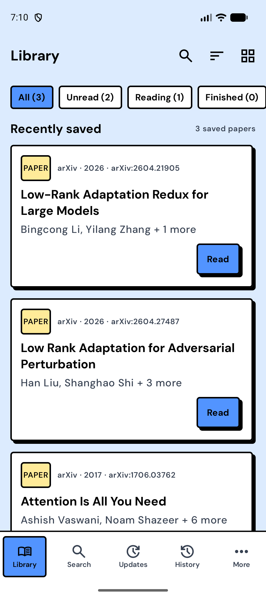
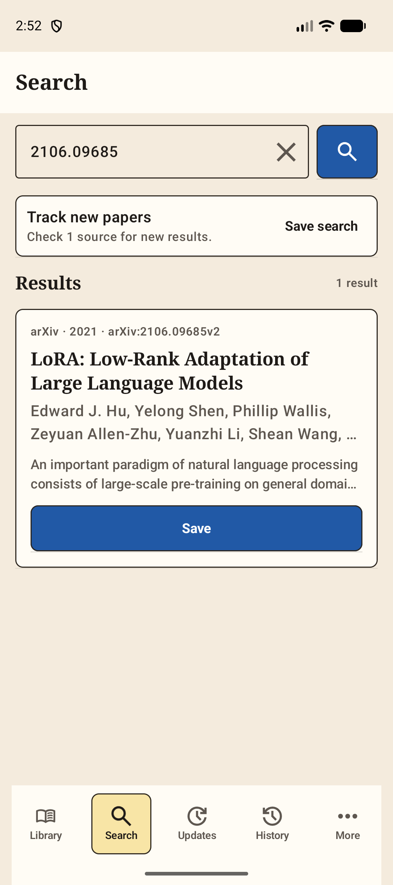
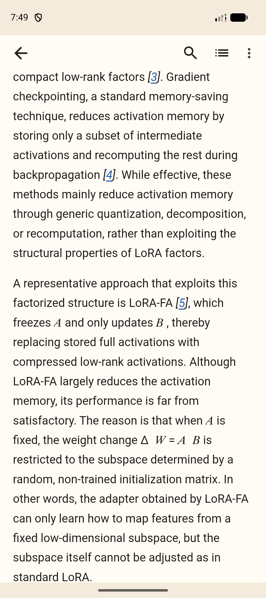

# PaperReader

A local-first Android app to discover, save, and read scholarly papers.
Pre-1.0; requires Android 9 (API 28) or newer.

[](https://github.com/ImAno177/PaperReader/actions/workflows/android-ci.yml)
[](LICENSE)

## Features

- Search Semantic Scholar, arXiv, and Europe PMC through separately installed source extensions;
  enrich exact DOI metadata with Crossref.
- Read supported arXiv papers in a mobile layout with figures, equations, search, highlights,
  and notes. Open original PDFs or import local PDFs.
- Keep downloaded documents available offline and organize papers with collections, bookmarks,
  reading history, saved searches, and metadata backups.
- Choose built-in themes or verified theme extensions. Library data and reading state stay local;
  no account, analytics, or advertising SDK is required.

## Screenshots

<p align="center">
  
  
  
</p>

## Build

Use JDK 21, Android SDK Platform 37.0, and Build-Tools 36.1.0. From the repository root:

```powershell
.\gradlew.bat :app:assembleDebug
```

APK: `app/build/outputs/apk/debug/app-debug.apk`.
See [Testing](docs/TESTING.md) for unit tests, lint, connected checks, and CI requirements.

## Get started

1. Install compatible signed sources from [PaperReader-sources](https://github.com/ImAno177/PaperReader-sources)
   to enable online search.
2. Search by title, phrase, DOI, arXiv ID, PMID, or PMCID, then save a paper to your Library.
3. Choose **Read** for a supported mobile document or open the original PDF. Download documents
   before reading offline.

## Documentation and support

- [Product specification](docs/SPEC.md): current behavior and deferred scope.
- [Architecture](docs/ARCHITECTURE.md): module boundaries and ownership.
- [Extensions](docs/EXTENSIONS.md): source and theme contracts, installation, and trust.
- [Contributing](CONTRIBUTING.md): development and pull request workflow.
- [Changelog](CHANGELOG.md): release history and unreleased changes.
- [Issues](https://github.com/ImAno177/PaperReader/issues): bugs and questions.
- [Security](SECURITY.md): private vulnerability reporting.

Licensed under [Apache 2.0](LICENSE). See [NOTICE](NOTICE) and
[third-party notices](THIRD_PARTY_NOTICES.md) for attributions.
